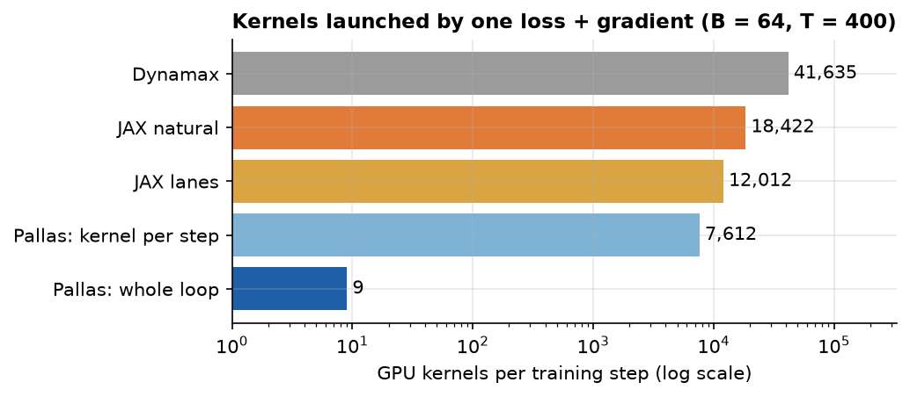
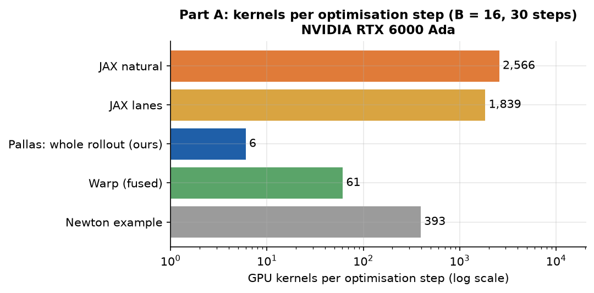

# Your JAX loop is too small for your GPU

*How to see it with a profiler, and how to fix it with Pallas kernels that differentiate themselves.*

> Measured 2026-11-19 on an NVIDIA RTX 6000 Ada (48 GB) with driver 595.99.02 and an AMD Ryzen Threadripper PRO 9955WX CPU.
> The Python 3.12 benchmarks ran sequentially. One-second samples showed no competing CUDA compute process. A GNOME graphics context was present.

---

## TL;DR

* Many scientific models are a **long loop of tiny steps**: a Kalman filter over a sensor log, a simulator rolled
  out for model-predictive control, an ODE solver. Written in natural JAX, each step becomes **dozens to hundreds of
  tiny GPU kernels**. The GPU spends its time starting kernels, not computing.
* We show it on two **official examples from other libraries**:
  * Dynamax's pendulum filter launched 41,635 kernels per gradient at B = 64. At B = 1, its GPU gradient took 17.7× as long as its CPU gradient.
  * **NVIDIA Newton/Warp**'s differentiable drone (model-predictive control): 393 kernels per optimisation step.
* The fix: put **the whole loop in one Pallas kernel**, and get the backward pass by running **`jax.vjp` inside a
  second kernel**. No derivative is written by hand, and derivatives *of* derivatives (Jacobians inside the loss)
  come for free.
* At B = 1, the pendulum gradient took **59.93 ms with Dynamax and 0.231 ms with Pallas (259.9×)**. The 300-step fit took 19.37 s and 0.098 s respectively.
* At B = 16, the first-order drone gradient took 0.056 ms with Pallas, 0.162 ms with fused Warp and 0.917 ms with the official Newton example.

| Pendulum EKF | Kernels per gradient (B = 64) | ms per gradient (B = 1) | 300 Adam steps (B = 16) |
|---|---:|---:|---:|
| Dynamax (GPU) | 41,635 | 59.93 | 19.37 s |
| Dynamax (CPU) | – | 3.39 | – |
| **Pallas whole loop (GPU)** | 9 | 0.231 | 0.098 s |

---

## 1. The problem: a small step in a long loop

Take one step of an extended Kalman filter for a pendulum: a 2-vector, a 2×2 covariance, a `sin`, a `cos`, a
division. A few hundred floating-point operations. Do it 400 times (a 5-second sensor log), then differentiate the
result to learn a parameter.

In JAX you write this with `lax.scan`, and XLA turns the loop body into GPU kernels. But XLA cannot fuse everything
in the body into one kernel: matrix products, reductions, `jacfwd`, the bookkeeping of the backward pass and the
library's own structure each become separate kernels.

For a gradient that launches $N$ short kernels in sequence, a useful time model is
$T_{\rm wall} \approx N(\bar t_{\rm kernel} + \bar t_{\rm gap})$, where the gap term includes dispatch and synchronization.
Each pendulum EKF step does only a few hundred arithmetic operations per sequence, yet its forward and backward
passes launch many separate kernels. At $B=1$, Dynamax launched 32,427 kernels for a gradient that took 59.93 ms.
That gives an effective wall time of $c = T_{\rm wall}/N \approx 1.85\,\mu\mathrm{s}$ per kernel.

Nsight Systems measured 1.30 µs of execution per kernel, or 42.28 ms summed over the gradient. That is about 71%
of the separately timed 59.93 ms. The remaining 17.65 ms estimates the time outside kernel execution, including
gaps between launches. Profiling and wall timing used separate runs, so this breakdown is approximate.
[Batch-1 kernel profile](example2_pendulum_vs_dynamax/results/kernels_b1.json) · [Wall timings](example2_pendulum_vs_dynamax/results/timings.json)

How much arithmetic could fit in one such interval? Using the RTX 6000 Ada's peak FP32 rate gives

$$W = P_{\rm peak}\,c \approx 91.1 \times 10^{12}\ \frac{\mathrm{FLOP}}{\mathrm{s}}
\times 1.85 \times 10^{-6}\ \mathrm{s} \approx 1.7 \times 10^8\ \mathrm{FLOP}.$$

This is a peak-throughput yardstick. A tiny kernel doing a fraction of one EKF step uses very little of that
capacity. The faster the GPU, the more arithmetic is forgone in each microsecond spent on a tiny kernel.
[NVIDIA RTX 6000 Ada specifications](https://www.nvidia.com/en-us/products/workstations/rtx-6000/)

Dynamax shows both diagnostic signs of a launch-bound loop.

1. **Batch scaling.** Increasing the batch from 1 to 4,096 sequences increased GPU time by only
   $72.80/59.93 \approx 1.21\times$. The larger batch put more work into each launch.
2. **Small-batch CPU performance.** At $B=1$, the CPU finished in 3.39 ms and the GPU in 59.93 ms.
   The CPU was $59.93/3.39 \approx 17.7\times$ faster.


## 2. Seeing it: counting kernels with Nsight Systems

Wall-clock time tells you *that* something is slow; the kernel count tells you *why*. Wrap the calls you want to
measure in `cudaProfilerStart/Stop` ([`common/timing.py`](common/timing.py), `profiler_range`) and run:

```bash
nsys profile --capture-range=cudaProfilerApi --capture-range-end=stop \
             --cuda-graph-trace=node -t cuda -o report  python my_script.py
nsys stats --report cuda_gpu_kern_sum --format csv report.nsys-rep
```

`--cuda-graph-trace=node` matters: XLA puts some kernels into CUDA graphs, and without it nsys reports a whole graph
as one item. [`common/nsys_count.py`](common/nsys_count.py) does this and sums the table.

For Dynamax's EKF, one loss + gradient over 64 sequences × 400 steps:

```
Dynamax                    41,635 kernels/gradient  (104.09 per EKF step)  mean 1.00 us
JAX natural                18,422 kernels/gradient  ( 46.05 per EKF step)  mean 1.05 us
JAX lanes                  11,212 kernels/gradient  ( 28.03 per EKF step)  mean 1.05 us
Pallas: kernel per step     7,612 kernels/gradient  ( 19.03 per EKF step)  mean 1.02 us
Pallas: whole loop              9 kernels/gradient  (  0.02 per EKF step)  mean 29.48 us
```

Dynamax averaged 104.1 kernels per EKF step. Nsight recorded 1.00 µs per kernel on average and 41.70 ms of summed kernel duration per gradient. The unprofiled wall times below also include dispatch and synchronization.



## 3. The fix in four ideas

### Idea 1 — write the step "per row"

Instead of a function of one state vector, write the step with **every scalar replaced by an array over many
problems** (a "lane"). The 2×2 covariance becomes three arrays $(p_{00}, p_{01}, p_{11})$; a quaternion becomes four.
The code is still ordinary `jax.numpy` and runs fine in plain JAX
([`ekf_jax.py`](example2_pendulum_vs_dynamax/ekf_jax.py), `ekf_step_lanes`):

```python
def ekf_step_lanes(lanes):
    m0, m1, p00, p01, p11, y, g, r = lanes                    # each an array over sequences
    one, zero = jnp.ones_like(m0), jnp.zeros_like(m0)
    y_hat, h0 = jax.jvp(sensor, (m0,), (one,))                # H = dh/dx, by autodiff
    S = h0 * p00 * h0 + r * r
    ...
    (n0, n1), (f00, f10) = jax.jvp(f, (m0, m1), (one, zero))  # columns of F = df/dx, by autodiff
    _, (f01, f11) = jax.jvp(f, (m0, m1), (zero, one))
    ...
```

On its own this only helps XLA a little (18,422 → 11,212 kernels). Its real purpose: it is exactly the shape a GPU
kernel wants, so the same function can run **inside** a kernel.

### Idea 2 — put the whole loop inside one kernel

A Pallas kernel body is ordinary JAX code, including `lax.fori_loop`. So the 400 time steps run *inside* one kernel,
with the state in registers. One program handles a block of 32 sequences
([`ekf_pallas.py`](example2_pendulum_vs_dynamax/ekf_pallas.py), `make_filter_op`):

```python
def forward_kernel(ys_ref, g_ref, r_ref, ll_ref, saved_ref):
    g, r = g_ref[0, :], r_ref[0, :]
    def body(t, carry):
        state, ll_sum = carry
        for k in range(5):                                    # keep the state for the backward pass
            saved_ref[t, k, :] = state[k]
        *state, ll = ekf_step_lanes((*state, ys_ref[t, :], g, r))
        return tuple(state), ll_sum + ll
    _, ll_sum = jax.lax.fori_loop(0, T, body, (initial_lanes(block), jnp.zeros_like(g)))
    ll_ref[0, :] = ll_sum
```

### Idea 3 — let JAX differentiate *inside* the backward kernel

`jax.grad` cannot see through a `pallas_call`. But we can write the backward pass as a second kernel that walks the
steps backwards and, at each step, calls **`jax.vjp` of the same step function inside the kernel**. JAX generates
all the derivative code; Pallas compiles it like any other code:

```python
def backward_kernel(ys_ref, g_ref, r_ref, saved_ref, ll_bar_ref, g_bar_ref, r_bar_ref):
    def body(i, carry):
        t = T - 1 - i                                         # backwards in time
        state_bar, g_bar, r_bar = carry
        lanes = (*(saved_ref[t, k, :] for k in range(5)), ys_ref[t, :], g, r)
        _, pullback = jax.vjp(ekf_step_lanes, lanes)          # autodiff INSIDE the kernel
        (lanes_bar,) = pullback((*state_bar, ll_bar))
        return tuple(lanes_bar[:5]), g_bar + lanes_bar[6], r_bar + lanes_bar[7]
    ...
```

Because `ekf_step_lanes` already contains `jax.jvp` (for the Jacobians $F$ and $H$), the backward kernel contains a
**second-order derivative** — a `vjp` of a `jvp` — that nobody wrote by hand.

### Idea 4 — tell `jax.grad` about it

`jax.custom_vjp` connects the two kernels, so the rest of the program (`jax.value_and_grad`, `optax`) does not know
anything changed:

```python
@jax.custom_vjp
def op(ys, g, r):
    return run_forward(ys, g, r)[0]

def op_fwd(ys, g, r):
    ll, saved = run_forward(ys, g, r)
    return ll, (ys, g, r, saved)

def op_bwd(residuals, ll_bar):
    g_bar, r_bar = run_backward(*residuals, ll_bar)
    return jnp.zeros_like(residuals[0]), g_bar, r_bar

op.defvjp(op_fwd, op_bwd)
```

For steps too big for one kernel, [`common/row_kernel.py`](common/row_kernel.py) packages ideas 1, 3 and 4 as a
generic "one fused kernel per step" helper (`make_row_op`), about 60 lines.

---

## 4. Example 2 — Dynamax's pendulum, learning gravity through an EKF

**Source:** Dynamax's notebook `ekf_ukf_pendulum.ipynb` (Särkkä, Example 3.7). Math and code:
[`example2_pendulum_vs_dynamax/`](example2_pendulum_vs_dynamax/README.md).

$$x_{k+1} = \begin{bmatrix} \alpha + \dot\alpha\,\Delta t \\ \dot\alpha - g\sin\alpha\,\Delta t\end{bmatrix} + q_k,
\qquad y_k = \sin\alpha_k + r_k, \qquad
L(g, r) = -\frac{1}{BT}\sum_{b,k} \log \mathcal N\big(y_k^{(b)};\ h(m_k),\ H P_k H^\top + r^2\big).$$

The loss needs the Jacobian $F = \partial f / \partial x$ at every step (to propagate $P$), so its gradient needs
$\partial F / \partial g$: second-order autodiff through 400 sequential steps.


**Correctness** (B = 64, float32 on the GPU vs. a float64 CPU reference):

| implementation | loss rel. error | gradient rel. error |
|---|---|---|
| Dynamax | 7.6e-08 | 3.4e-04 |
| JAX natural | 7.6e-08 | 1.3e-05 |
| JAX lanes | 1.1e-08 | 4.7e-05 |
| Pallas, kernel per step | 1.1e-08 | 4.8e-05 |
| Pallas, whole loop | 1.1e-08 | 4.8e-05 |

**Speed** (ms per loss + gradient, T = 400, RTX 6000 Ada and Threadripper CPU):

| B | Dynamax GPU | Dynamax CPU | JAX natural GPU | JAX natural CPU | JAX lanes GPU | Pallas per step | **Pallas whole loop** |
|---:|---:|---:|---:|---:|---:|---:|---:|
| 1 | 59.93 | 3.39 | 20.21 | 1.33 | 13.54 | 6.90 | 0.231 |
| 16 | 65.30 | 8.15 | 21.39 | 1.43 | 12.76 | 6.96 | 0.274 |
| 256 | 63.97 | 84.13 | 22.79 | 11.51 | 14.23 | 7.84 | 0.282 |
| 4096 | 72.80 | – | 27.15 | – | 15.05 | 8.57 | 0.289 |

**Learning $g$ and $r$** (300 Adam steps, 16 sequences, start $(8.0, 0.4)$): all three implementations take the same
steps and land on the same maximum-likelihood estimate $(g, r) = (9.504, 0.299)$ (true $(9.8, 0.3)$; 16 five-second
sequences do not pin $g$ down further).


## 5. Example 1 — NVIDIA's differentiable drone, vs. Warp

**Source:** Newton's official example `example_diffsim_drone.py` (built on NVIDIA Warp). Model-predictive control
improves a quadrotor's propeller commands by gradient descent through a 30-step simulation, for 16 rollouts at once.
Math and code: [`example1_drone_vs_warp/`](example1_drone_vs_warp/README.md).

Warp is designed for exactly this: one kernel per simulation step (a thread per rollout), automatic adjoint
kernels, and the whole forward + backward pass captured as a CUDA graph. We compare:

* **Newton's example** itself (its captured graph),
* **our Warp version** (same physics, one fused kernel per step, `wp.Tape`, CUDA graph),
* **natural JAX** and **per-row JAX**,
* **Pallas: the whole 30-step rollout in one kernel**, backward with `jax.vjp` inside.

The JAX, Pallas and fused Warp implementations agree with the float64 reference to about 1e-6.

### Part A — the example as written (first-order gradient)

| Implementation | Kernels per gradient (B = 16) | ms, B = 16 | ms, B = 256 | ms, B = 4096 |
|---|---:|---:|---:|---:|
| Newton example (Warp) | 393 | 0.917 | 1.25 | 1.91 |
| Warp (ours) | 61 | 0.162 | 0.294 | 0.302 |
| JAX natural | 2,566 | 2.79 | 3.23 | 3.84 |
| JAX lanes | 1,839 | 2.38 | 2.38 | 2.51 |
| **Pallas whole rollout** | 6 | 0.056 | 0.066 | 0.066 |

At B = 16, Pallas was 2.9× faster than fused Warp and 16.5× faster than Newton’s example.





### Part B — a cost with a Jacobian inside

Real controllers care about uncertainty. Propagate a small start-tilt error through the **linearised** simulator
(the covariance step of an EKF) and penalise the resulting position spread:

$$\delta_{k+1} = F_k\,\delta_k,\quad F_k = \frac{\partial\,\text{step}}{\partial\,\text{state}}, \qquad
c_k \mathrel{+}= 100 \sum_j \lVert \delta_{kj}[x] \rVert^2 .$$

The gradient w.r.t. the controls now needs $\partial F_k / \partial c$. In JAX that is one line (`jax.jacfwd` or
`jax.jvp`, differentiated again by `jax.grad`); the Pallas kernels get it the same way. **Warp's released autodiff is
first-order reverse mode only**: you would have to hand-write $F_k\,\delta$ for the quaternion integrator and let
Warp differentiate that. (Warp's development branch has an experimental forward mode, "jets", which may change this
in a future release.)

| Implementation | Kernels per gradient (B = 16) | ms, B = 16 | ms, B = 256 | ms, B = 4096 |
|---|---:|---:|---:|---:|
| Warp 1.19 (requires a hand-written Jacobian) | – | – | – | – |
| JAX natural | 4,801 | 5.91 | 6.92 | 15.39 |
| JAX lanes | 2,925 | 4.56 | 4.96 | 5.33 |
| **Pallas whole rollout** | 8 | 0.096 | 0.085 | 0.184 |

At B = 16, Pallas took 0.096 ms for the uncertainty-aware gradient, a 61.9× speedup over natural JAX. All three implementations agree with the float64 reference to about 1e-6.


---

## 6. When does this matter? Count the derivatives inside your loss

Let $d$ be the number of derivatives *inside* your forward computation. Training needs automatic differentiation of
order $d + 1$.

| $d$ | examples | Warp (released) | JAX + Pallas |
|---|---|---|---|
| 0 | rollout loss, trajectory optimisation, Part A | ✅ built for it | ✅ |
| ≥ 1 | Kalman filters (Jacobian $F$), force fields ($f = -\nabla E$), physics-informed losses ($u_{xx}$), DDP / iLQR, finance Greeks, Hamiltonian models ($\nabla H$) | hand-write the inner derivatives | ✅ automatic |

Fields where $d \ge 1$ is everyday business: molecular dynamics and materials, state estimation (vehicles, drones,
batteries), scientific ML and PDEs, weather and climate data assimilation, quantitative finance.

## 7. When it does not help

* **Big per-step work.** A 2048-wide MLP at batch 4,096 is already compute-bound; cuBLAS does it near peak. Fusion
  helps most when launch overhead accounts for a substantial fraction of wall time.
* **Branch-heavy code** (contact detection, mesh queries) suits Warp's thread-per-problem model better.
* **Huge batches** amortise the launch overhead on their own (that is how RL simulators cope).
* **Kernel size.** An earlier version of the uncertainty-aware drone carried three tangents per row. Triton was
  still compiling its backward kernel after 15 minutes. Giving each tangent its own row recomputes the state
  update but makes the differentiated step smaller. On the RTX 6000 Ada, the one-tangent version completed its
  first call, including compilation and execution, in 5.7 s at B = 16. Larger steps can be split across kernels.
  [Per-step kernel implementation](common/row_kernel.py)
* **Compile time.** Pallas/Triton kernels take seconds to minutes to compile; Warp's NVRTC compile is faster.
* **Hardware.** This used Pallas' Triton backend on an NVIDIA RTX 6000 Ada.

## 8. Related work

* [*Why jax.lax.scan Is Slow on GPU and How Pallas Fixes It*](https://lin-wang.notion.site/Why-jax-lax-scan-Is-Slow-on-GPU-and-How-Pallas-Fixes-It-34ad45b463ed801eba72e885994b2708)
  (Lin Wang): a forward-only toy ODE in one Pallas kernel, 67× over Diffrax. This post adds the backward pass,
  derivatives inside the loss, profiling, and comparisons with Dynamax and Warp.
* [jaccpot PR #343](https://github.com/TobiBu/jaccpot/pull/343): `custom_vjp` + reverse Pallas kernels built from
  `jax.vjp` (N-body gravity). [cryojax PR #612](https://github.com/michael-0brien/cryojax/pull/612): a
  forward-over-reverse rule for Pallas kernels.
* [Locality-aware automatic differentiation on the GPU](https://arxiv.org/abs/2509.00406): second-order AD kept in
  on-chip memory for mesh energies.
* [JAX discussion #22611](https://github.com/jax-ml/jax/discussions/22611): each `lax.scan` iteration is a kernel
  launch on GPU.
* [Dynamax](https://github.com/probml/dynamax), [NVIDIA Warp](https://github.com/NVIDIA/warp),
  [Newton](https://github.com/newton-physics/newton).

## 9. Reproduce

```bash
pip install -r requirements.txt          # JAX 0.8.2 (CUDA), Dynamax 1.0.3, Warp 1.19, Newton 1.8
export CUDA_VISIBLE_DEVICES=0            # choose an idle GPU
python -m example2_pendulum_vs_dynamax.check_correctness
python -m example2_pendulum_vs_dynamax.benchmark            # timings
python -m example2_pendulum_vs_dynamax.benchmark --kernels  # needs nsys on PATH
python -m example2_pendulum_vs_dynamax.fit_gravity
python -m example2_pendulum_vs_dynamax.make_figures
python -m example1_drone_vs_warp.check_correctness
python -m example1_drone_vs_warp.uncertainty
python -m example1_drone_vs_warp.benchmark
python -m example1_drone_vs_warp.benchmark --uncertainty
python -m example1_drone_vs_warp.benchmark --kernels
python -m example1_drone_vs_warp.benchmark --uncertainty --kernels
python -m example1_drone_vs_warp.make_figures
```

GPU runs used FP32 with `jax_default_matmul_precision = "highest"`. Timings are median synchronized wall times after warm-up (20 GPU and 10 CPU evaluations for the pendulum, 50 GPU evaluations for the drone). The 300-step fit includes the optimizer and host reads and excludes the warm-up step. Nsight Systems 2026.1.3 counted kernel launches in a separate capture of three warmed calls. Speedups use the unrounded wall times.

Median and first-call timings are available for the [pendulum](example2_pendulum_vs_dynamax/results/timings.json), [first-order drone](example1_drone_vs_warp/results/timings.json) and [uncertainty-aware drone](example1_drone_vs_warp/results/timings_uncertainty.json). The [fit history](example2_pendulum_vs_dynamax/results/fit.json) records all 300 optimizer steps.

| folder | contents |
|---|---|
| [`common/`](common/) | `row_kernel.py` (generic fused kernel + in-kernel `jax.vjp`), `timing.py`, `nsys_count.py`, `plot_style.py` |
| [`example1_drone_vs_warp/`](example1_drone_vs_warp/README.md) | Newton's drone: physics, JAX / Pallas / Warp versions, uncertainty cost, benchmarks |
| [`example2_pendulum_vs_dynamax/`](example2_pendulum_vs_dynamax/README.md) | Dynamax's pendulum EKF: Dynamax / JAX / Pallas versions, benchmarks, learning $g$ |
