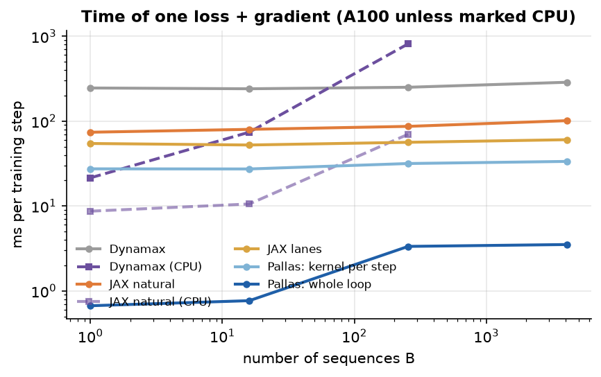
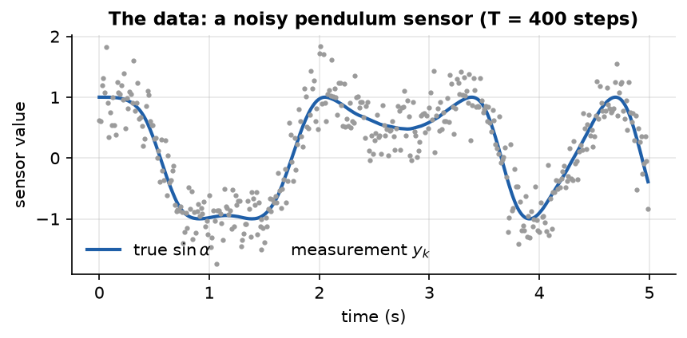
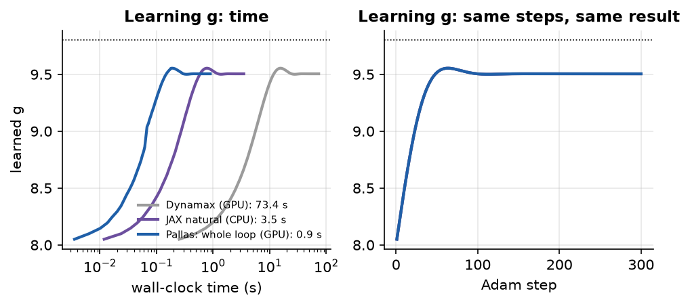
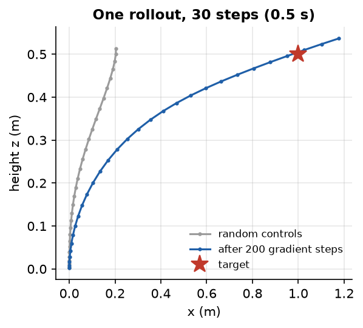
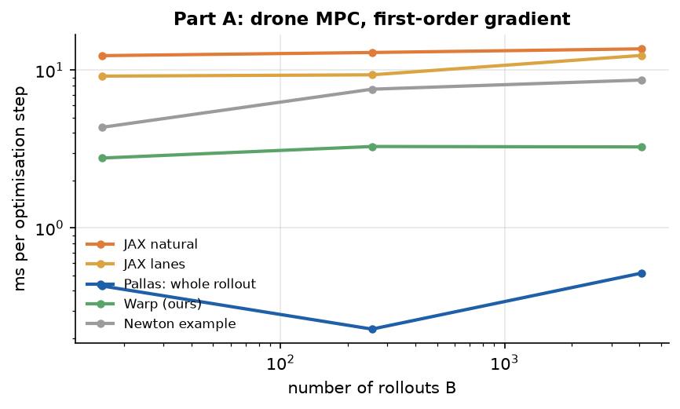
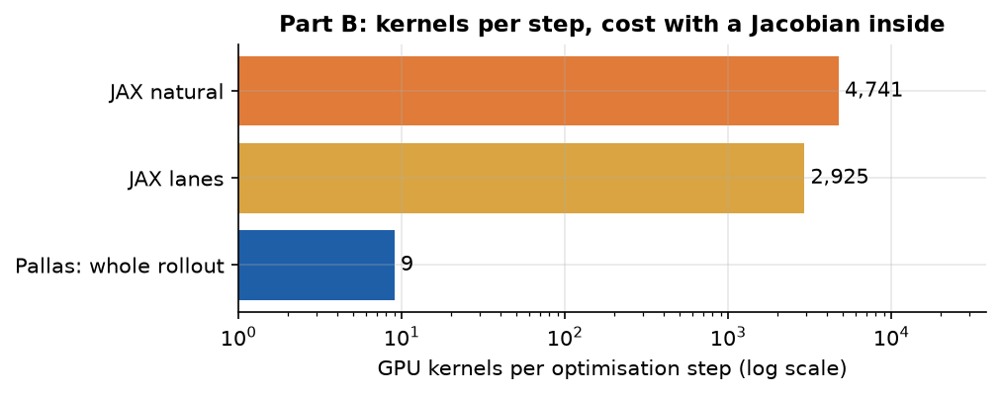

# Your JAX loop is too small for your GPU

*How to see it with a profiler, and how to fix it with Pallas kernels that differentiate themselves.*

> **Draft.** The timings below were measured on an A100 that was shared with another job; they will be re-measured
> on an idle GPU before publishing. Kernel counts and correctness results are not affected by the sharing.

---

## TL;DR

* Many scientific models are a **long loop of tiny steps**: a Kalman filter over a sensor log, a simulator rolled
  out for model-predictive control, an ODE solver. Written in natural JAX, each step becomes **dozens to hundreds of
  tiny GPU kernels**. The GPU spends its time starting kernels, not computing.
* We show it on two **official examples from other libraries**:
  * **Dynamax**'s pendulum extended Kalman filter (learning gravity from data): **41,635 kernels** for one gradient,
    and the GPU is **12× slower than the CPU**.
  * **NVIDIA Newton/Warp**'s differentiable drone (model-predictive control): ~390 kernels per optimisation step.
* The fix: put **the whole loop in one Pallas kernel**, and get the backward pass by running **`jax.vjp` inside a
  second kernel**. No derivative is written by hand, and derivatives *of* derivatives (Jacobians inside the loss)
  come for free.
* Results (preliminary): the pendulum gradient goes from **246 ms (Dynamax) to 0.67 ms (≈ 370×)**, with
  **9 kernels instead of 41,635**; learning $g$ takes **0.9 s instead of 73 s**. The drone rollout gradient takes
  **0.43 ms vs 2.8 ms (Warp) and 4.4 ms (Newton's example)**, and unlike Warp it also handles a cost with a
  Jacobian inside.

| | kernels per gradient | time per gradient | learning $g$ |
|---|---|---|---|
| Dynamax EKF (GPU) | 41,635 | 246 ms | 73.4 s |
| Dynamax EKF (CPU) | – | 21 ms | – |
| **Pallas: whole filter in one kernel (GPU)** | **9** | **0.67 ms** | **0.89 s** |

---

## 1. The problem: a small step in a long loop

Take one step of an extended Kalman filter for a pendulum: a 2-vector, a 2×2 covariance, a `sin`, a `cos`, a
division. A few hundred floating-point operations. Do it 400 times (a 5-second sensor log), then differentiate the
result to learn a parameter.

In JAX you write this with `lax.scan`, and XLA turns the loop body into GPU kernels. But XLA cannot fuse everything
in the body into one kernel: matrix products, reductions, `jacfwd`, the bookkeeping of the backward pass and the
library's own structure each become separate kernels. Every kernel launch takes a couple of microseconds, **whatever
it computes**:

$$t_{\text{step}} \;\approx\; N_{\text{kernels}} \times c, \qquad c \approx 2.5\ \mu\text{s on an A100}.$$

A rule of thumb: in $c = 2.5\ \mu$s an A100 could do about $19.5 \times 10^{12} \times 2.5 \times 10^{-6} \approx
5 \times 10^{7}$ FP32 operations. A kernel that does **far less work than that** is dominated by its launch.
Our EKF kernels each do a few hundred operations per sequence.

Two tell-tale signs:

1. **The time does not grow with the batch.** 1 sequence or 4,096 sequences take about the same time (the GPU is idle
   either way).
2. **The CPU wins** for small batches.



## 2. Seeing it: counting kernels with Nsight Systems

Wall-clock time tells you *that* something is slow; the kernel count tells you *why*. Wrap the calls you want to
measure in `cudaProfilerStart/Stop` ([`common/timing.py`](common/timing.py), `profiler_range`) and run:

```bash
nsys profile --capture-range=cudaProfilerApi --capture-range-end=stop \
             --cuda-graph-trace=node -t cuda -o report  python my_script.py
nsys stats --report cuda_gpu_kern_sum --format csv report.nsys-rep
```

`--cuda-graph-trace=node` matters: XLA puts some kernels into CUDA graphs, and without it nsys reports a whole graph
as one item. [`common/nsys_count.py`](common/nsys_count.py) does this and sums the table.

For Dynamax's EKF, one loss + gradient over 64 sequences × 400 steps:

```
Dynamax                        41635 kernels/step  ( 104.1 per EKF step)  mean 2.44 us
JAX natural                    18422 kernels/step  (  46.1 per EKF step)  mean 3.07 us
JAX lanes                      12012 kernels/step  (  30.0 per EKF step)  mean 3.26 us
Pallas: kernel per step         7612 kernels/step  (  19.0 per EKF step)  mean 2.81 us
Pallas: whole loop                 9 kernels/step  (   0.0 per EKF step)  mean 64.02 us
```

**104 kernels for every EKF step**, each running for 2.4 µs. That is the whole story.


## 3. The fix in four ideas

### Idea 1 — write the step "per row"

Instead of a function of one state vector, write the step with **every scalar replaced by an array over many
problems** (a "lane"). The 2×2 covariance becomes three arrays $(p_{00}, p_{01}, p_{11})$; a quaternion becomes four.
The code is still ordinary `jax.numpy` and runs fine in plain JAX
([`ekf_jax.py`](example2_pendulum_vs_dynamax/ekf_jax.py), `ekf_step_lanes`):

```python
def ekf_step_lanes(lanes):
    m0, m1, p00, p01, p11, y, g, r = lanes                    # each an array over sequences
    one, zero = jnp.ones_like(m0), jnp.zeros_like(m0)
    y_hat, h0 = jax.jvp(sensor, (m0,), (one,))                # H = dh/dx, by autodiff
    S = h0 * p00 * h0 + r * r
    ...
    (n0, n1), (f00, f10) = jax.jvp(f, (m0, m1), (one, zero))  # columns of F = df/dx, by autodiff
    _, (f01, f11) = jax.jvp(f, (m0, m1), (zero, one))
    ...
```

On its own this only helps XLA a little (18,422 → 12,012 kernels). Its real purpose: it is exactly the shape a GPU
kernel wants, so the same function can run **inside** a kernel.

### Idea 2 — put the whole loop inside one kernel

A Pallas kernel body is ordinary JAX code, including `lax.fori_loop`. So the 400 time steps run *inside* one kernel,
with the state in registers. One program handles a block of 32 sequences
([`ekf_pallas.py`](example2_pendulum_vs_dynamax/ekf_pallas.py), `make_filter_op`):

```python
def forward_kernel(ys_ref, g_ref, r_ref, ll_ref, saved_ref):
    g, r = g_ref[0, :], r_ref[0, :]
    def body(t, carry):
        state, ll_sum = carry
        for k in range(5):                                    # keep the state for the backward pass
            saved_ref[t, k, :] = state[k]
        *state, ll = ekf_step_lanes((*state, ys_ref[t, :], g, r))
        return tuple(state), ll_sum + ll
    _, ll_sum = jax.lax.fori_loop(0, T, body, (initial_lanes(block), jnp.zeros_like(g)))
    ll_ref[0, :] = ll_sum
```

### Idea 3 — let JAX differentiate *inside* the backward kernel

`jax.grad` cannot see through a `pallas_call`. But we can write the backward pass as a second kernel that walks the
steps backwards and, at each step, calls **`jax.vjp` of the same step function inside the kernel**. JAX generates
all the derivative code; Pallas compiles it like any other code:

```python
def backward_kernel(ys_ref, g_ref, r_ref, saved_ref, ll_bar_ref, g_bar_ref, r_bar_ref):
    def body(i, carry):
        t = T - 1 - i                                         # backwards in time
        state_bar, g_bar, r_bar = carry
        lanes = (*(saved_ref[t, k, :] for k in range(5)), ys_ref[t, :], g, r)
        _, pullback = jax.vjp(ekf_step_lanes, lanes)          # autodiff INSIDE the kernel
        (lanes_bar,) = pullback((*state_bar, ll_bar))
        return tuple(lanes_bar[:5]), g_bar + lanes_bar[6], r_bar + lanes_bar[7]
    ...
```

Because `ekf_step_lanes` already contains `jax.jvp` (for the Jacobians $F$ and $H$), the backward kernel contains a
**second-order derivative** — a `vjp` of a `jvp` — that nobody wrote by hand.

### Idea 4 — tell `jax.grad` about it

`jax.custom_vjp` connects the two kernels, so the rest of the program (`jax.value_and_grad`, `optax`) does not know
anything changed:

```python
@jax.custom_vjp
def op(ys, g, r):
    return run_forward(ys, g, r)[0]

def op_fwd(ys, g, r):
    ll, saved = run_forward(ys, g, r)
    return ll, (ys, g, r, saved)

def op_bwd(residuals, ll_bar):
    g_bar, r_bar = run_backward(*residuals, ll_bar)
    return jnp.zeros_like(residuals[0]), g_bar, r_bar

op.defvjp(op_fwd, op_bwd)
```

For steps too big for one kernel, [`common/row_kernel.py`](common/row_kernel.py) packages ideas 1, 3 and 4 as a
generic "one fused kernel per step" helper (`make_row_op`), about 60 lines.

---

## 4. Example 2 — Dynamax's pendulum, learning gravity through an EKF

**Source:** Dynamax's notebook `ekf_ukf_pendulum.ipynb` (Särkkä, Example 3.7). Math and code:
[`example2_pendulum_vs_dynamax/`](example2_pendulum_vs_dynamax/README.md).

$$x_{k+1} = \begin{bmatrix} \alpha + \dot\alpha\,\Delta t \\ \dot\alpha - g\sin\alpha\,\Delta t\end{bmatrix} + q_k,
\qquad y_k = \sin\alpha_k + r_k, \qquad
L(g, r) = -\frac{1}{BT}\sum_{b,k} \log \mathcal N\big(y_k^{(b)};\ h(m_k),\ H P_k H^\top + r^2\big).$$

The loss needs the Jacobian $F = \partial f / \partial x$ at every step (to propagate $P$), so its gradient needs
$\partial F / \partial g$: second-order autodiff through 400 sequential steps.



**Correctness** (B = 64, float32 on the GPU vs. a float64 CPU reference):

| implementation | loss rel. error | gradient rel. error |
|---|---|---|
| Dynamax | 7.6e-08 | 3.4e-04 |
| JAX natural | 7.6e-08 | 1.3e-05 |
| JAX lanes | 1.1e-08 | 4.7e-05 |
| Pallas, kernel per step | 1.1e-08 | 4.8e-05 |
| Pallas, whole loop | 1.1e-08 | 4.8e-05 |

**Speed** (ms per loss + gradient, T = 400; preliminary, shared GPU):

| B | Dynamax GPU | Dynamax CPU | JAX natural GPU | JAX natural CPU | Pallas per step | **Pallas whole loop** |
|---|---|---|---|---|---|---|
| 1 | 245.8 | 21.5 | 74.0 | 8.7 | 27.4 | **0.67** |
| 16 | 240.7 | 74.1 | 80.0 | 10.6 | 27.3 | **0.77** |
| 256 | 250.7 | 815.5 | 86.8 | 70.1 | 31.7 | **3.34** |
| 4096 | 287.2 | – | 101.3 | – | 33.5 | **3.52** |

**Learning $g$ and $r$** (300 Adam steps, 16 sequences, start $(8.0, 0.4)$): all three implementations take the same
steps and land on the same maximum-likelihood estimate $(g, r) = (9.504, 0.299)$ (true $(9.8, 0.3)$; 16 five-second
sequences do not pin $g$ down further).



## 5. Example 1 — NVIDIA's differentiable drone, vs. Warp

**Source:** Newton's official example `example_diffsim_drone.py` (built on NVIDIA Warp). Model-predictive control
improves a quadrotor's propeller commands by gradient descent through a 30-step simulation, for 16 rollouts at once.
Math and code: [`example1_drone_vs_warp/`](example1_drone_vs_warp/README.md).

Warp is designed for exactly this: one kernel per simulation step (a thread per rollout), automatic adjoint
kernels, and the whole forward + backward pass captured as a CUDA graph. We compare:

* **Newton's example** itself (its captured graph),
* **our Warp version** (same physics, one fused kernel per step, `wp.Tape`, CUDA graph),
* **natural JAX** and **per-row JAX**,
* **Pallas: the whole 30-step rollout in one kernel**, backward with `jax.vjp` inside.

All agree with a float64 reference to ~1e-6.

### Part A — the example as written (first-order gradient)

| implementation | kernels per optimisation step (B = 16) | ms, B = 16 | ms, B = 256 | ms, B = 4096 |
|---|---|---|---|---|
| Newton example (Warp) | 393 | 4.35 | 7.58 | 8.67 |
| Warp (ours) | 61 | 2.78 | 3.29 | 3.27 |
| JAX natural | 2,537 | 12.38 | 12.96 | 13.67 |
| JAX lanes | 1,809 | 9.18 | 9.36 | 12.42 |
| **Pallas whole rollout** | **6** | **0.43** | **0.23** | **0.52** |

*(preliminary, shared GPU: Warp's GPU-busy time is only 0.30 ms per step, so on an idle GPU its wall time will be
much closer to Pallas'.)*





### Part B — a cost with a Jacobian inside

Real controllers care about uncertainty. Propagate a small start-tilt error through the **linearised** simulator
(the covariance step of an EKF) and penalise the resulting position spread:

$$\delta_{k+1} = F_k\,\delta_k,\quad F_k = \frac{\partial\,\text{step}}{\partial\,\text{state}}, \qquad
c_k \mathrel{+}= 100 \sum_j \lVert \delta_{kj}[x] \rVert^2 .$$

The gradient w.r.t. the controls now needs $\partial F_k / \partial c$. In JAX that is one line (`jax.jacfwd` or
`jax.jvp`, differentiated again by `jax.grad`); the Pallas kernels get it the same way. **Warp's released autodiff is
first-order reverse mode only**: you would have to hand-write $F_k\,\delta$ for the quaternion integrator and let
Warp differentiate that. (Warp's development branch has an experimental forward mode, "jets", which may change this
in a future release.)

| implementation | kernels per optimisation step (B = 16) | ms, B = 16 | ms, B = 256 | ms, B = 4096 |
|---|---|---|---|---|
| Warp (released) | – (needs a hand-written Jacobian) | – | – | – |
| JAX natural (`jax.jacfwd`) | 4,741 | 22.48 | 26.71 | 41.83 |
| JAX lanes (`jax.jvp`) | 2,925 | 17.94 | 18.30 | 21.87 |
| **Pallas whole rollout** (`jvp` in the kernel, `vjp` of it in the backward kernel) | **9** | **2.56** | **1.49** | **2.92** |

*(preliminary, shared GPU; Pallas' GPU-busy time is 0.13 ms per step at B = 16.)* All three agree with a float64
reference to ~1e-6 (cost and gradient).



---

## 6. When does this matter? Count the derivatives inside your loss

Let $d$ be the number of derivatives *inside* your forward computation. Training needs automatic differentiation of
order $d + 1$.

| $d$ | examples | Warp (released) | JAX + Pallas |
|---|---|---|---|
| 0 | rollout loss, trajectory optimisation, Part A | ✅ built for it | ✅ |
| ≥ 1 | Kalman filters (Jacobian $F$), force fields ($f = -\nabla E$), physics-informed losses ($u_{xx}$), DDP / iLQR, finance Greeks, Hamiltonian models ($\nabla H$) | hand-write the inner derivatives | ✅ automatic |

Fields where $d \ge 1$ is everyday business: molecular dynamics and materials, state estimation (vehicles, drones,
batteries), scientific ML and PDEs, weather and climate data assimilation, quantitative finance.

## 7. When it does not help

* **Big per-step work.** A 2048-wide MLP at batch 4,096 is already compute-bound; cuBLAS does it near peak. Fusion
  only helps when each kernel does far less than ~$5 \times 10^7$ operations.
* **Branch-heavy code** (contact detection, mesh queries) suits Warp's thread-per-problem model better.
* **Huge batches** amortise the launch overhead on their own (that is how RL simulators cope).
* **Kernel size.** The step must fit in registers. Big step bodies (thousands of operations, especially after a
  `vjp` of a `jvp`) make Triton compile slowly and spill registers. We hit this in Part B: carrying three tangent
  vectors per row gave a backward kernel that had not compiled after 15 minutes; giving each tangent its own row
  (the state is simply recomputed per row) brought the first call down to 16 s. If a step is still too big, split it
  into a few kernels ([`common/row_kernel.py`](common/row_kernel.py)).
* **Compile time.** Pallas/Triton kernels take seconds to minutes to compile; Warp's NVRTC compile is faster.
* **Hardware.** This used Pallas' Triton backend on an NVIDIA A100.

## 8. Related work

* [*Why jax.lax.scan Is Slow on GPU and How Pallas Fixes It*](https://lin-wang.notion.site/Why-jax-lax-scan-Is-Slow-on-GPU-and-How-Pallas-Fixes-It-34ad45b463ed801eba72e885994b2708)
  (Lin Wang): a forward-only toy ODE in one Pallas kernel, 67× over Diffrax. This post adds the backward pass,
  derivatives inside the loss, profiling, and comparisons with Dynamax and Warp.
* [jaccpot PR #343](https://github.com/TobiBu/jaccpot/pull/343): `custom_vjp` + reverse Pallas kernels built from
  `jax.vjp` (N-body gravity). [cryojax PR #612](https://github.com/michael-0brien/cryojax/pull/612): a
  forward-over-reverse rule for Pallas kernels.
* [Locality-aware automatic differentiation on the GPU](https://arxiv.org/abs/2509.00406): second-order AD kept in
  on-chip memory for mesh energies.
* [JAX discussion #22611](https://github.com/jax-ml/jax/discussions/22611): each `lax.scan` iteration is a kernel
  launch on GPU.
* [Dynamax](https://github.com/probml/dynamax), [NVIDIA Warp](https://github.com/NVIDIA/warp),
  [Newton](https://github.com/newton-physics/newton).

## 9. Reproduce

```bash
pip install -r requirements.txt          # JAX 0.8.2 (CUDA), Dynamax 1.0.3, Warp 1.19, Newton 1.8
cd jax_pallas
python -m example2_pendulum_vs_dynamax.check_correctness
python -m example2_pendulum_vs_dynamax.benchmark            # timings
python -m example2_pendulum_vs_dynamax.benchmark --kernels  # needs nsys on PATH
python -m example2_pendulum_vs_dynamax.fit_gravity
python -m example2_pendulum_vs_dynamax.make_figures
python -m example1_drone_vs_warp.check_correctness
python -m example1_drone_vs_warp.uncertainty
python -m example1_drone_vs_warp.benchmark [--uncertainty] [--kernels]
python -m example1_drone_vs_warp.make_figures
```

All runs use true FP32 (`jax_default_matmul_precision = "highest"`; on an A100 JAX otherwise uses TF32 for matrix
products).

| folder | contents |
|---|---|
| [`common/`](common/) | `row_kernel.py` (generic fused kernel + in-kernel `jax.vjp`), `timing.py`, `nsys_count.py`, `plot_style.py` |
| [`example1_drone_vs_warp/`](example1_drone_vs_warp/README.md) | Newton's drone: physics, JAX / Pallas / Warp versions, uncertainty cost, benchmarks |
| [`example2_pendulum_vs_dynamax/`](example2_pendulum_vs_dynamax/README.md) | Dynamax's pendulum EKF: Dynamax / JAX / Pallas versions, benchmarks, learning $g$ |
