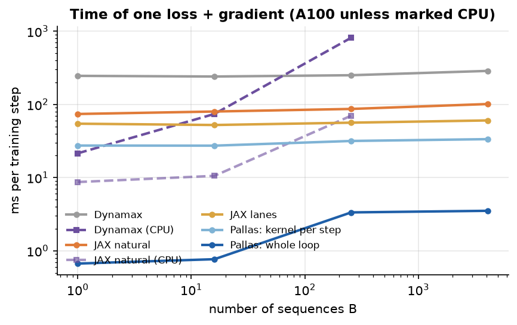
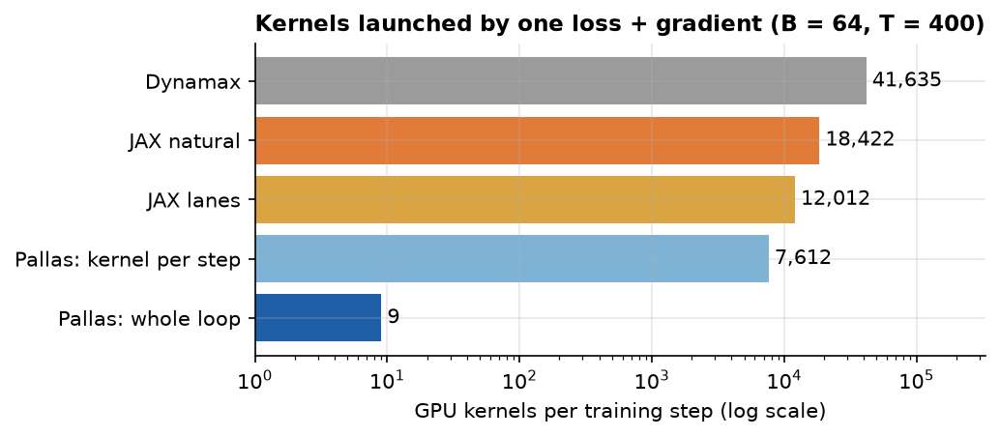
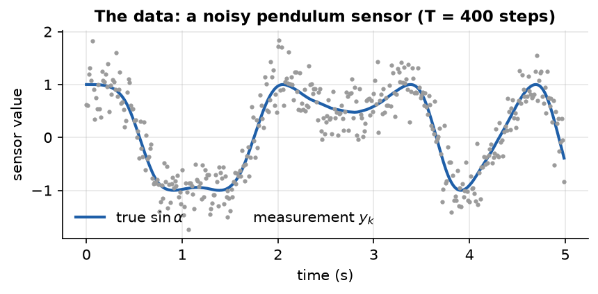
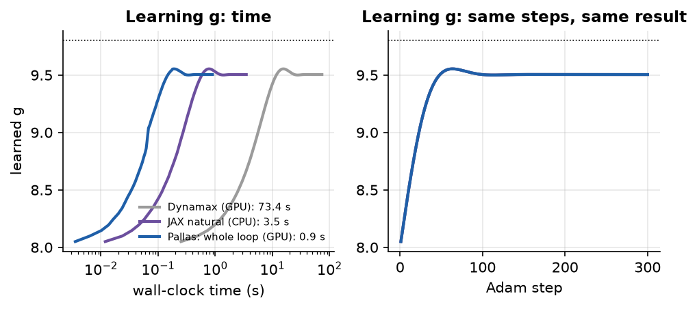
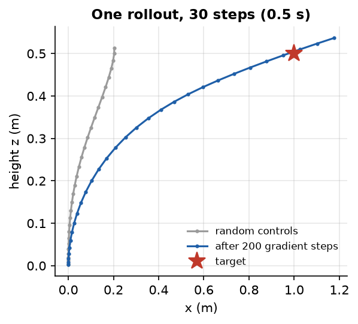
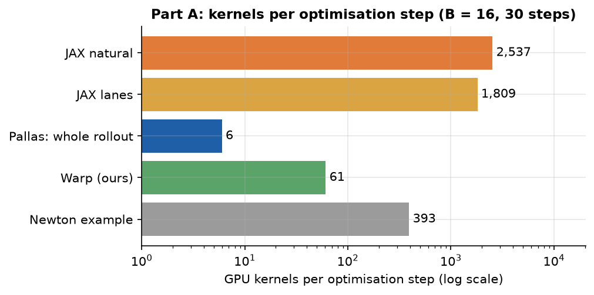
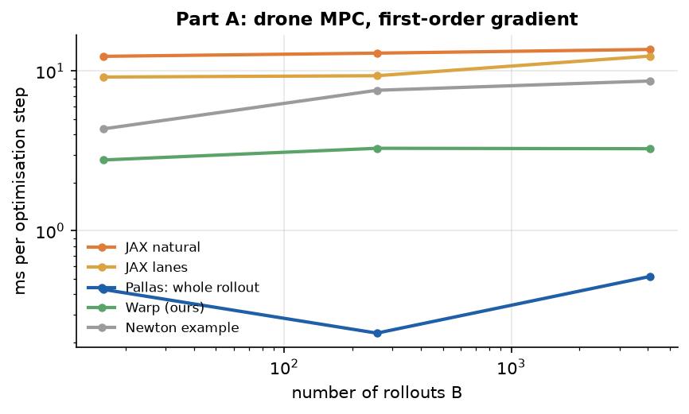
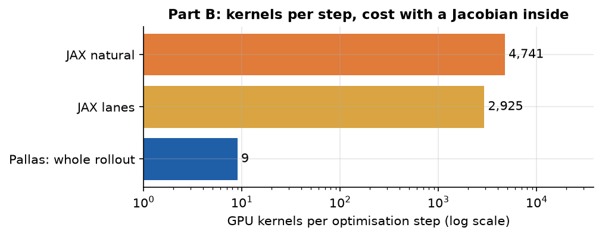
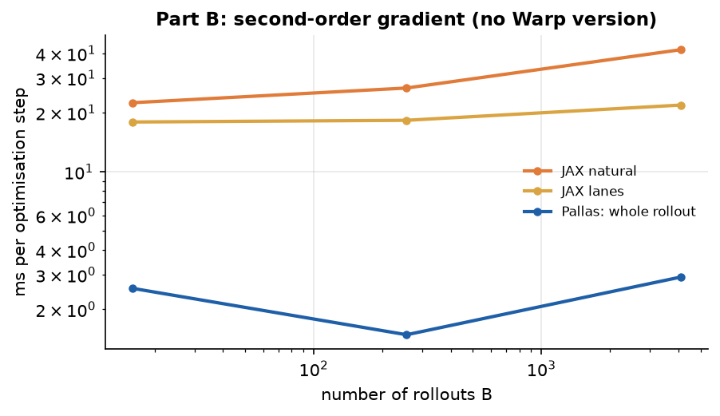

# Accelerating Higher-Order Automatic Differentiation for Sequential Scientific Computing

*Fused GPU kernels with in-kernel automatic differentiation in JAX and Pallas, demonstrated on state estimation and
model-predictive control.*

> **Draft.** The timings below were measured on an NVIDIA A100 that was shared with another job. They will be
> re-measured on an idle GPU before publication. Kernel counts and correctness results are not affected by the sharing.

---

## Abstract

Many scientific models are long loops of small steps: an extended Kalman filter over a sensor log, a simulator
rolled out for model-predictive control, or the time stepping of an ODE solver. Training them often needs
**higher-order** automatic differentiation, because the forward computation already contains a derivative (a
Jacobian for covariance propagation, a force computed as a gradient of an energy). In natural JAX, each step of such a
loop compiles to dozens or hundreds of tiny GPU kernels. The runtime is then set by **kernel-launch overhead**,
not by arithmetic, and a GPU can be slower than a CPU.

We present a simple recipe that removes this bottleneck:

1. Write the step with one array per scalar (a "per-row" layout).
2. Run the **entire loop inside one Pallas kernel**.
3. Obtain the backward pass from a second kernel that applies **`jax.vjp` inside the kernel**.
4. Connect the two kernels with `jax.custom_vjp`.

No derivative is written by hand, and derivatives of derivatives are generated automatically.

We evaluate the recipe on two official examples from established libraries:

* **Dynamax's pendulum extended Kalman filter**, where we learn gravity and sensor noise through the filter's
  log-likelihood (second-order automatic differentiation). One gradient drops from **41,635 kernels to 9** and from
  **246 ms to 0.67 ms**. Learning the parameters takes **0.9 s instead of 73 s**.
* **NVIDIA Newton/Warp's differentiable drone** (model-predictive control). The first-order gradient runs in
  **6 kernels instead of 393**. An uncertainty-aware variant with a Jacobian inside the objective (second order),
  which released Warp cannot differentiate automatically, runs in **9 kernels**.

| implementation (pendulum EKF, one gradient, $B = 64$) | kernels per gradient | time per gradient ($B = 1$) | learning $g$ and $r$ |
|---|---|---|---|
| Dynamax EKF (GPU) | 41,635 | 246 ms | 73.4 s |
| Dynamax EKF (CPU) | – | 21 ms | – |
| **Pallas: whole filter in one kernel (GPU)** | **9** | **0.67 ms** | **0.89 s** |

---

## 1. Introduction

### 1.1 Sequential programs with derivatives inside

A large class of scientific programs has the form

$$s_{k+1} = \Phi(s_k, \theta, u_k), \qquad k = 0, \dots, T-1, \qquad L(\theta) = \sum_{k} \ell(s_k, \theta),$$

where:

* $s_k$ is a small state (a few to a few dozen numbers);
* $\Phi$ is a cheap step (hundreds to thousands of floating-point operations);
* $T$ is long (tens to thousands of steps);
* we need $\nabla_\theta L$ for learning, calibration or control.

Often the step $\Phi$ itself contains a derivative:

* an extended Kalman filter propagates its covariance with the Jacobian $F_k = \partial f / \partial x$;
* molecular dynamics computes forces as $f = -\nabla E$;
* physics-informed losses contain $u_{xx}$;
* Hamiltonian models evolve along $\nabla H$.

### 1.2 The derivative-order rule

Let $d$ be the number of derivatives nested *inside* the forward computation. Training then needs automatic
differentiation of order

$$\text{order} = d + 1.$$

| $d$ | examples | order needed for training |
|---|---|---|
| 0 | rollout objectives, trajectory optimisation | 1 (ordinary gradient) |
| 1 | Kalman filters, force fields, Hamiltonian models, physics-informed losses | 2 |
| 2 | Hessian-based methods (Newton steps, DDP/iLQR with second-order terms) inside the loop | 3 |

Higher-order automatic differentiation is routine in JAX: `jax.grad` of a function that calls `jax.jacfwd` simply
works. The difficulty is performance on GPUs, which we explain next.

---

## 2. Why sequential programs are launch-bound on GPUs

In JAX a loop is written with `lax.scan`, and XLA compiles the loop body into GPU kernels. XLA cannot fuse the whole
body into one kernel. Matrix products, reductions, `jacfwd`, the bookkeeping of the backward pass and the library's
own structure each become separate kernels. Every kernel launch takes a few microseconds, **whatever it computes**.
The time per loop step is therefore approximately

$$t_{\text{step}} \;\approx\; N_{\text{kernels}} \times c, \qquad c \approx 2.5\ \mu\text{s on an A100}.$$

**When is a kernel too small?** In $c = 2.5\ \mu$s an A100 can perform about

$$19.5 \times 10^{12}\ \tfrac{\text{FLOP}}{\text{s}} \times 2.5 \times 10^{-6}\ \text{s} \;\approx\; 5 \times 10^{7}\ \text{FLOP}.$$

A kernel that does far less work than $W \approx 5 \times 10^7$ FLOP is dominated by its launch. One EKF step for the
pendulum performs a few hundred operations per sequence.

Two diagnostic signs of a launch-bound program:

1. **The runtime is nearly independent of the batch size.** One sequence and 4,096 sequences take about the same
   time, because the GPU is idle in both cases.
2. **The CPU is faster than the GPU** for small batches.

Both appear for Dynamax's EKF (below): the GPU time stays near 250 ms from $B = 1$ to $B = 4096$, while the CPU takes
21 ms at $B = 1$.



---

## 3. Diagnosis: counting kernels with NVIDIA Nsight Systems

Wall-clock time shows *that* a program is slow. The kernel count shows *why*. We wrap the calls to be measured in
`cudaProfilerStart` / `cudaProfilerStop` (the context manager `profiler_range` in
[`common/timing.py`](common/timing.py)) and run:

```bash
nsys profile --capture-range=cudaProfilerApi --capture-range-end=stop \
             --cuda-graph-trace=node -t cuda -o report  python my_script.py
nsys stats --report cuda_gpu_kern_sum --format csv report.nsys-rep
```

* `--capture-range=cudaProfilerApi` records only the region between the two profiler calls, so compilation and
  warm-up are excluded.
* `--capture-range-end=stop` ends the capture cleanly without terminating the application.
* `--cuda-graph-trace=node` is essential. XLA places some kernels in CUDA graphs, and without this flag nsys reports
  a whole graph as a single item.

[`common/nsys_count.py`](common/nsys_count.py) automates this and reports kernels per call, GPU-busy time and mean
kernel duration. For one loss-and-gradient evaluation of the pendulum EKF ($B = 64$ sequences, $T = 400$ steps):

```
Dynamax                        41635 kernels/step  ( 104.1 per EKF step)  mean 2.44 us
JAX natural                    18422 kernels/step  (  46.1 per EKF step)  mean 3.07 us
JAX lanes                      12012 kernels/step  (  30.0 per EKF step)  mean 3.26 us
Pallas: kernel per step         7612 kernels/step  (  19.0 per EKF step)  mean 2.81 us
Pallas: whole loop                 9 kernels/step  (   0.0 per EKF step)  mean 64.02 us
```

Dynamax launches **104 kernels per EKF step**, each running for 2.4 µs on average. This accounts for the entire
runtime: $41{,}635 \times 2.44\ \mu\text{s} \approx 102$ ms of pure kernel time, plus launch gaps.



---

## 4. Method: the whole loop in one kernel, with automatic differentiation inside

### 4.1 Per-row layout

Instead of a function of one state vector, we write the step with **every scalar replaced by an array over many
independent problems** (a "lane" or "row"):

* the 2×2 covariance becomes three arrays $(p_{00}, p_{01}, p_{11})$;
* a quaternion becomes four arrays.

The code remains ordinary `jax.numpy` and runs in plain JAX
([`ekf_jax.py`](example2_pendulum_vs_dynamax/ekf_jax.py), `ekf_step_lanes`):

```python
def ekf_step_lanes(lanes):
    m0, m1, p00, p01, p11, y, g, r = lanes                    # each an array over sequences
    one, zero = jnp.ones_like(m0), jnp.zeros_like(m0)
    y_hat, h0 = jax.jvp(sensor, (m0,), (one,))                # H = dh/dx, by autodiff
    S = h0 * p00 * h0 + r * r
    ...
    (n0, n1), (f00, f10) = jax.jvp(f, (m0, m1), (one, zero))  # columns of F = df/dx, by autodiff
    _, (f01, f11) = jax.jvp(f, (m0, m1), (zero, one))
    ...
```

On its own this layout reduces the kernel count only modestly (18,422 → 12,012). Its purpose is that it is exactly
the shape a GPU kernel expects, so the same function can run **inside** a kernel.

### 4.2 The whole loop inside one forward kernel

A Pallas kernel body is ordinary JAX code, including `lax.fori_loop`. All $T$ time steps therefore run inside one
kernel, with the state held in registers. Each program instance processes a block of 32 problems
([`ekf_pallas.py`](example2_pendulum_vs_dynamax/ekf_pallas.py), `make_filter_op`):

```python
def forward_kernel(ys_ref, g_ref, r_ref, ll_ref, saved_ref):
    g, r = g_ref[0, :], r_ref[0, :]
    def body(t, carry):
        state, ll_sum = carry
        for k in range(5):                                    # keep the state for the backward pass
            saved_ref[t, k, :] = state[k]
        *state, ll = ekf_step_lanes((*state, ys_ref[t, :], g, r))
        return tuple(state), ll_sum + ll
    _, ll_sum = jax.lax.fori_loop(0, T, body, (initial_lanes(block), jnp.zeros_like(g)))
    ll_ref[0, :] = ll_sum
```

The starting state of every step, $s_k$, is written to GPU memory. This costs $T \times n_s$ numbers per problem and
is all the backward pass needs.

### 4.3 The backward kernel, with `jax.vjp` inside

`jax.grad` cannot differentiate through a `pallas_call`. We therefore write the backward pass as a second kernel that
walks the steps in reverse. Writing $\bar s_k = \partial L / \partial s_k$ for the cotangent of the state, the
reverse recursion is

$$\bar s_k = \Big(\frac{\partial \Phi}{\partial s}\Big|_{s_k}\Big)^{\!\top} \bar s_{k+1} + \frac{\partial \ell_k}{\partial s_k},
\qquad \bar\theta \mathrel{+}= \Big(\frac{\partial \Phi}{\partial \theta}\Big|_{s_k}\Big)^{\!\top} \bar s_{k+1} + \frac{\partial \ell_k}{\partial \theta}.$$

Both vector-Jacobian products are obtained by calling **`jax.vjp` of the same step function inside the kernel**. JAX
generates the derivative code and Pallas compiles it like any other code:

```python
def backward_kernel(ys_ref, g_ref, r_ref, saved_ref, ll_bar_ref, g_bar_ref, r_bar_ref):
    def body(i, carry):
        t = T - 1 - i                                         # backwards in time
        state_bar, g_bar, r_bar = carry
        lanes = (*(saved_ref[t, k, :] for k in range(5)), ys_ref[t, :], g, r)
        _, pullback = jax.vjp(ekf_step_lanes, lanes)          # autodiff INSIDE the kernel
        (lanes_bar,) = pullback((*state_bar, ll_bar))
        return tuple(lanes_bar[:5]), g_bar + lanes_bar[6], r_bar + lanes_bar[7]
    ...
```

Because `ekf_step_lanes` already contains `jax.jvp` (for the Jacobians $F$ and $H$), the backward kernel contains a
**second-order derivative**, a `vjp` of a `jvp`, that is never written by hand. The same construction extends to any
order $d + 1$.

### 4.4 Integration with `jax.grad` via `jax.custom_vjp`

`jax.custom_vjp` connects the two kernels, so the rest of the program (`jax.value_and_grad`, `optax`) is unchanged:

```python
@jax.custom_vjp
def op(ys, g, r):
    return run_forward(ys, g, r)[0]

def op_fwd(ys, g, r):
    ll, saved = run_forward(ys, g, r)
    return ll, (ys, g, r, saved)

def op_bwd(residuals, ll_bar):
    g_bar, r_bar = run_backward(*residuals, ll_bar)
    return jnp.zeros_like(residuals[0]), g_bar, r_bar

op.defvjp(op_fwd, op_bwd)
```

For steps too large for a whole-loop kernel, [`common/row_kernel.py`](common/row_kernel.py) packages Sections 4.1, 4.3
and 4.4 as a generic "one fused kernel per step" helper (`make_row_op`, about 60 lines).

### 4.5 Summary of the recipe

| step | what it does | kernels per gradient |
|---|---|---|
| natural JAX (`vmap` + `lax.scan`) | one XLA loop, many kernels per step | $\mathcal O(10\text{–}100) \times T$ |
| per-row layout (4.1) | same maths, kernel-friendly shape | slightly fewer |
| whole loop in one kernel (4.2) | forward pass in one launch | 1 forward |
| in-kernel `jax.vjp` (4.3) + `custom_vjp` (4.4) | backward pass in one launch, any derivative order | 1 backward (+ a few small kernels) |

---

## 5. Case study: state estimation — learning a pendulum through an extended Kalman filter (vs. Dynamax)

**Source.** The pendulum in [Dynamax](https://github.com/probml/dynamax)'s own EKF notebook
(`ekf_ukf_pendulum.ipynb`, after Särkkä, *Bayesian Filtering and Smoothing*, Example 3.7). We go one step beyond the
notebook. Instead of only filtering, we **learn** the gravity $g$ and the sensor noise $r$ by gradient descent on the
EKF log-likelihood. Code: [`example2_pendulum_vs_dynamax/`](example2_pendulum_vs_dynamax/README.md).

### 5.1 Model

The state is the angle and angular velocity, $x = [\alpha,\ \dot\alpha]$, with time step $\Delta t = 0.0125$ s:

$$x_{k+1} = f(x_k) + q_k, \qquad f(x) = \begin{bmatrix} \alpha + \dot\alpha\,\Delta t \\ \dot\alpha - g \sin\alpha\,\Delta t \end{bmatrix}, \qquad q_k \sim \mathcal N(0, Q),$$

$$y_k = h(x_k) + r_k, \qquad h(x) = \sin\alpha, \qquad r_k \sim \mathcal N(0, r^2),$$

with process noise from a continuous white-noise acceleration of intensity $q_c = 1$:

$$Q = q_c \begin{bmatrix} \Delta t^3/3 & \Delta t^2/2 \\ \Delta t^2/2 & \Delta t \end{bmatrix}.$$

The true values are $g = 9.8$ and $r = 0.3$. Each sequence has $T = 400$ steps (5 s) and starts at
$x_0 = [\pi/2,\ 0]$.



### 5.2 One step of the extended Kalman filter

The filter maintains a Gaussian belief $\mathcal N(m_k, P_k)$. It uses Dynamax's order (measure, update, predict)
and the Jacobians $H = \partial h / \partial x$ and $F = \partial f / \partial x$:

| quantity | formula | meaning |
|---|---|---|
| innovation variance | $S = H P H^\top + r^2$ | uncertainty of the next measurement |
| innovation | $e = y - h(m)$ | measurement minus prediction |
| log-likelihood | $\ell = -\tfrac12\left(\log 2\pi S + e^2 / S\right)$ | how well the model predicted $y$ |
| gain | $K = P H^\top / S$ | weight given to the measurement |
| update | $m \leftarrow m + K e$, $\;P \leftarrow P - K S K^\top$ | belief after observing $y$ |
| predict | $m \leftarrow f(m)$, $\;P \leftarrow F P F^\top + Q$ | belief for the next step |

For the pendulum, $H = [\cos\alpha,\ 0]$ and

$$F = \begin{bmatrix} 1 & \Delta t \\ -g\cos\alpha\,\Delta t & 1 \end{bmatrix}.$$

These Jacobians are never written by hand. As in Dynamax (`F, H = jacfwd(f), jacfwd(h)`), they come from
`jax.jacfwd` in the natural implementation and from `jax.jvp` in the per-row implementation.

### 5.3 Training objective and why it is second order

The loss is the negative log-likelihood per measurement, averaged over $B$ sequences:

$$L(g, r) = -\frac{1}{B\,T} \sum_{b=1}^{B} \sum_{k=1}^{T} \ell_k^{(b)}(g, r).$$

The chain of dependencies runs $\ell_k \leftarrow S_k \leftarrow P_k \leftarrow F_{k-1}, F_{k-2}, \dots$, so the
gradient $\partial L / \partial g$ contains $\partial F_j / \partial g$, **the derivative of a Jacobian**. One
derivative sits inside the forward computation ($d = 1$), and training needs automatic differentiation of order
$d + 1 = 2$ through 400 sequential steps.

### 5.4 Implementations

| implementation | description |
|---|---|
| Dynamax | `extended_kalman_filter(...).marginal_loglik` (baseline) |
| JAX natural | the same filter written directly: `jax.jacfwd`, `lax.scan` |
| JAX lanes | per-row layout (Section 4.1), `lax.scan` |
| Pallas, kernel per step | one fused kernel per EKF step (`common/row_kernel.py`) |
| **Pallas, whole loop** | the whole filter in one forward and one backward kernel (Sections 4.2–4.4) |

### 5.5 Correctness

$B = 64$; float32 on the GPU compared with a float64 CPU reference:

| implementation | loss relative error | gradient relative error |
|---|---|---|
| Dynamax | 7.6e-08 | 3.4e-04 |
| JAX natural | 7.6e-08 | 1.3e-05 |
| JAX lanes | 1.1e-08 | 4.7e-05 |
| Pallas, kernel per step | 1.1e-08 | 4.8e-05 |
| Pallas, whole loop | 1.1e-08 | 4.8e-05 |

### 5.6 Performance

Milliseconds per loss-and-gradient evaluation, $T = 400$ (preliminary, shared GPU):

| $B$ | Dynamax GPU | Dynamax CPU | JAX natural GPU | JAX natural CPU | Pallas per step | **Pallas whole loop** |
|---|---|---|---|---|---|---|
| 1 | 245.8 | 21.5 | 74.0 | 8.7 | 27.4 | **0.67** |
| 16 | 240.7 | 74.1 | 80.0 | 10.6 | 27.3 | **0.77** |
| 256 | 250.7 | 815.5 | 86.8 | 70.1 | 31.7 | **3.34** |
| 4096 | 287.2 | – | 101.3 | – | 33.5 | **3.52** |

* All GPU implementations based on XLA are flat in $B$, the signature of a launch-bound program.
* The whole-loop kernel is about $370\times$ faster than Dynamax on the GPU at $B = 1$ and about $80\times$ faster at
  $B = 4096$.

### 5.7 Parameter learning

300 Adam steps (learning rate 0.05), 16 sequences, starting from $(g, r) = (8.0, 0.4)$:

| implementation | device | wall time for 300 steps | final $(g, r)$ |
|---|---|---|---|
| Dynamax | GPU | 73.4 s | (9.504, 0.299) |
| JAX natural | CPU | 3.5 s | (9.504, 0.299) |
| **Pallas, whole loop** | GPU | **0.89 s** | (9.504, 0.299) |

All three implementations follow the same optimisation path and reach the same maximum-likelihood estimate. The true
values are $(9.8, 0.3)$; sixteen five-second sequences do not determine $g$ more precisely.



---

## 6. Case study: model-predictive control — NVIDIA's differentiable drone (vs. Warp)

**Source.** Newton's official example
[`example_diffsim_drone.py`](https://github.com/newton-physics/newton/tree/main/newton/examples/diffsim), built on
[NVIDIA Warp](https://github.com/NVIDIA/warp). A quadrotor must fly to a target next to a pole. Its propeller commands
are improved by gradient descent through a 30-step simulation, for 16 rollouts at once. Code:
[`example1_drone_vs_warp/`](example1_drone_vs_warp/README.md).

* **Part A** is the example as published. The objective contains no derivatives ($d = 0$), so training needs
  first-order gradients, which is exactly what Warp is designed for.
* **Part B** adds an uncertainty term propagated with the simulator's Jacobian ($d = 1$). Training now needs a
  derivative of a derivative, which released Warp does not provide automatically.

### 6.1 Dynamics

The drone is one rigid body with mass $m = 0.56$ kg and inertia $I = \mathrm{diag}(0.00376,\ 0.00376,\ 0.00749)$
kg m². Its four propellers sit at $p_i \in \{(0, \pm 0.2, 0),\ (\pm 0.2, 0, 0)\}$ m. The state has 13 numbers:
position $x$, orientation quaternion $q$ (rotation matrix $R(q)$), velocity $v$ and angular velocity $\omega$.

**Controls.** Each propeller has 4 control points $c_{j,i}$ over the 30-step horizon, one every 10 steps. The command
at step $k$ is a piecewise-linear interpolation with "hat" weights, scaled by a gain of 0.8:

$$u_i(k) = 0.8 \sum_{j=0}^{3} \max\!\big(0,\ 1 - |k/10 - j|\big)\, c_{j,i}.$$

**Forces and torques.** Propeller $i$ produces thrust $T u_i$ along the body $z$ axis ($T = 4.18$ N) and drag torque
$\pm M u_i$ ($M = 0.0556$ N m), with spin directions $s = (-1, 1, 1, -1)$. Newton scales the torques by 0.8:

$$F = R\, e_z\, T \sum_i u_i, \qquad \tau_b = 0.8 \Big(\sum_i p_i \times e_z\, T u_i \;+\; e_z\, M \sum_i s_i u_i\Big).$$

**Integration.** One step of Newton's `SolverSemiImplicit`, with $\Delta t = 1/60$ s, gravity $g = -9.81\,e_z$ and
angular damping 0.05:

$$v_{k+1} = v_k + \Big(\frac{F}{m} + g\Big)\Delta t, \qquad x_{k+1} = x_k + v_{k+1}\,\Delta t,$$

$$\omega_b = R^\top\omega_k, \qquad \omega_b \leftarrow \omega_b + I^{-1}\big(\tau_b - \omega_b \times I\omega_b\big)\Delta t, \qquad \omega^+ = R\,\omega_b,$$

$$q_{k+1} = \mathrm{normalise}\Big(q_k + \tfrac12\,\Delta t\, (\omega^+, 0) \otimes q_k\Big), \qquad \omega_{k+1} = (1 - 0.05\,\Delta t)\, \omega^+.$$

[`drone.py`](example1_drone_vs_warp/drone.py) (`simulate_step`) is a line-by-line port of Newton's
`integrate_rigid_body` and `compute_prop_wrenches`.

### 6.2 Objective (Part A)

After each step $k = 0, \dots, 29$, Newton's `drone_cost` and `collision_cost` give

$$c_k = \frac{10^3}{\textstyle\sum w}\, \gamma_k \Big( 1000\,\lVert x - x^\star\rVert^2 + 100\, a(x_z) + 0.05\,\lVert u\rVert^2 + 0.1\,(\lVert v\rVert^2 + \lVert\omega\rVert^2) + 10\,(1 - e_z^\top R e_z) \Big) + 10^4 \max(0,\ 0.2 - d_{\text{pole}}).$$

The terms are:

* target $x^\star = (1, 0, 0.5)$;
* altitude penalty $a(z) = \max(z - 0.75, 0) + \max(0.25 - z, 0)$;
* discount $\gamma_k = 0.8^{29 - k}/30^2$;
* $d_{\text{pole}}$, the distance from the drone to a vertical capsule of radius 0.15 m.

Model-predictive control needs, at every optimisation step,

$$\nabla_c L, \qquad L = \sum_{b=1}^{B} \sum_{k=0}^{29} c_k^{(b)}.$$

### 6.3 Part B: an uncertainty-aware objective with a Jacobian inside

The drone does not know its initial tilt exactly. A small tilt error $\delta_0$ of 0.05 rad about $x$, $y$ or $z$
propagates along the rollout through the **linearised** dynamics:

$$\delta_{k+1} = F_k\,\delta_k, \qquad F_k = \frac{\partial\, \Phi}{\partial\, s}\Big|_{(s_k,\ u_k)}.$$

This is the covariance propagation of an extended Kalman filter, $P_{k+1} = F_k P_k F_k^\top$ with
$P_0 = \sum_j \delta_{0j}\delta_{0j}^\top$. We penalise the spread of the position:

$$c_k \mathrel{+}= 100\, \operatorname{tr}\big(P_k[x, x]\big) = 100 \sum_{j=1}^{3} \lVert \delta_{kj}[x] \rVert^2 .$$

The gradient $\nabla_c L$ now requires $\partial F_k / \partial c$, **the derivative of a Jacobian**: second-order
automatic differentiation through 30 steps.

* **JAX:** `jax.jacfwd` (natural form) or `jax.jvp` (per-row form). `jax.grad` differentiates it again automatically.
* **Pallas:** one row per (rollout $b$, error direction $j$). Each row carries the state and **one** tangent
  $\delta_{kj}$, and advances both with a single `jax.jvp` inside the forward kernel. The backward kernel applies
  `jax.vjp` to it, so the second-order derivative is generated inside the kernel
  ([`uncertainty.py`](example1_drone_vs_warp/uncertainty.py)).
* **Warp (release 1.19):** reverse mode only. `wp.Tape` cannot differentiate a gradient or a Jacobian again. The
  product $F_k\,\delta$ (quaternion product, normalisation, gyroscopic term) would have to be written by hand and
  then differentiated by Warp. Warp's development branch contains an *experimental* forward mode ("jets",
  `wp.JetSpace`), which may make this possible in a future release.

### 6.4 Implementations

| implementation | description | kernels per optimisation step |
|---|---|---|
| Newton example (Warp) | the official code, timed through its captured CUDA graph | ~390 |
| Warp (ours) | same physics; one fused kernel per step, `wp.Tape`, CUDA graph | 30 forward + 30 adjoint |
| JAX natural | small vectors, `vmap`, `lax.scan` | thousands |
| JAX lanes | per-row layout, `lax.scan` | fewer thousands |
| **Pallas whole rollout** | one kernel for the rollout, one for its backward pass (`jax.vjp` inside) | single digits |

### 6.5 Correctness

$B = 16$; float32 on the GPU compared with a float64 CPU reference:

| implementation | Part A: objective rel. error | Part A: gradient rel. error | Part B: objective rel. error | Part B: gradient rel. error |
|---|---|---|---|---|
| JAX natural | 5.5e-07 | 3.0e-07 | 7.4e-07 | 5.3e-07 |
| JAX lanes | 7.7e-07 | 4.6e-07 | 7.4e-07 | 2.1e-07 |
| Pallas whole rollout | 6.6e-07 | 4.6e-07 | 8.5e-07 | 1.9e-07 |
| Warp (ours) | 1.8e-06 | 4.8e-07 | – | – |

### 6.6 Performance, Part A (first-order gradient)

| implementation | kernels per step ($B = 16$) | ms, $B = 16$ | ms, $B = 256$ | ms, $B = 4096$ |
|---|---|---|---|---|
| Newton example (Warp) | 393 | 4.35 | 7.58 | 8.67 |
| Warp (ours) | 61 | 2.78 | 3.29 | 3.27 |
| JAX natural | 2,537 | 12.38 | 12.96 | 13.67 |
| JAX lanes | 1,809 | 9.18 | 9.36 | 12.42 |
| **Pallas whole rollout** | **6** | **0.43** | **0.23** | **0.52** |

*Preliminary, shared GPU.* Warp's GPU-busy time is only 0.30 ms per step, so on an idle GPU its wall time is expected
to be much closer to that of Pallas. For first-order gradients, a well-written Warp program and the fused Pallas
kernel are in the same class. The difference between them is Part B.







### 6.7 Performance, Part B (second-order gradient)

| implementation | kernels per step ($B = 16$) | ms, $B = 16$ | ms, $B = 256$ | ms, $B = 4096$ |
|---|---|---|---|---|
| Warp (released) | – (requires a hand-written Jacobian) | – | – | – |
| JAX natural (`jax.jacfwd`) | 4,741 | 22.48 | 26.71 | 41.83 |
| JAX lanes (`jax.jvp`) | 2,925 | 17.94 | 18.30 | 21.87 |
| **Pallas whole rollout** (`jvp` in the forward kernel, `vjp` of it in the backward kernel) | **9** | **2.56** | **1.49** | **2.92** |

*Preliminary, shared GPU.* The Pallas GPU-busy time is 0.13 ms per step at $B = 16$. First-call compile times are:
natural JAX 25 s, JAX lanes 9 s, Pallas 15.7 s.





---

## 7. Scope: where higher-order differentiation arises

### 7.1 Overview

| $d$ | examples | Warp (released) | JAX + Pallas |
|---|---|---|---|
| 0 | rollout objectives, trajectory optimisation (Part A) | ✅ designed for it | ✅ |
| ≥ 1 | Kalman filters (Jacobian $F$), force fields ($f = -\nabla E$), physics-informed losses ($u_{xx}$), DDP / iLQR, sensitivities in quantitative finance, Hamiltonian models ($\nabla H$) | inner derivatives written by hand | ✅ automatic |

Fields where $d \ge 1$ is routine:

* molecular dynamics and materials modelling;
* state estimation for vehicles, drones and batteries;
* scientific machine learning and PDEs;
* data assimilation in weather and climate;
* quantitative finance.

### 7.2 Governing equations by domain

Recall: $d$ is the number of derivatives inside the forward computation, and training needs automatic differentiation
of order $d+1$. In each row, the inner derivative is shown in bold.

| domain | governing equations (the inner derivative is in bold) | $d$ → order for training | what released Warp (1.19) requires |
|---|---|---|---|
| Molecular dynamics, ML force fields | $\mathbf{f = -\nabla_x E_\theta(x)}$, with loss $L = \sum \lVert -\nabla_x E_\theta - f^{\text{ref}} \rVert^2$ | $d=1$ → 2 (needs $\nabla_\theta \nabla_x E_\theta$) | The Tape cannot differentiate a gradient. $\nabla_x E_\theta$ must be written by hand as its own kernel. Large equivariant networks also live outside Warp. |
| State estimation (EKF), §5 | $\mathbf{F_k = \partial f/\partial x}$, $P_{k+1} = F_k P_k F_k^\top + Q$, $L = -\sum_k \log \mathcal N\big(y_k;\ h(m_k),\ H P_k H^\top + R\big)$ | $d=1$ → 2 | There is no forward mode to get $F$ and $H$, so they are written by hand for every new model. |
| Differentiable MPC, iLQR / DDP | $\mathbf{A_k = \partial f/\partial x,\ B_k = \partial f/\partial u}$ (and $\mathbf{f_{xx}}$ for DDP), Riccati gain $K_k = -(R + B_k^\top P B_k)^{-1} B_k^\top P A_k$ | iLQR $d=1$ → 2; DDP $d=2$ → 3 | Hand-written Jacobians and Hessians. With the Tape alone, a Jacobian costs one backward pass per output row. |
| Physics-informed ML, PDEs | Burgers residual $r = u_t + u\,u_x - \nu\, \mathbf{u_{xx}}$, $L = \sum r^2$; beam equation with $\mathbf{u_{xxxx}}$ | $d=2$ → 3; $d=4$ → 5 | Has no nested derivatives of a network with respect to its inputs, and no Taylor mode (JAX has `jax.experimental.jet`). |
| Weather and climate data assimilation (4D-Var) | $J(x_0) = \tfrac12\lVert x_0 - x_b\rVert^2_{B^{-1}} + \tfrac12 \sum_k \lVert y_k - \mathcal H(\mathcal M_k(x_0))\rVert^2_{R^{-1}}$, with the tangent-linear model $\mathbf{M_k = \partial \mathcal M_k / \partial x}$ | $d=1$ → 2 (when learning the model through 4D-Var) | No forward mode, so the tangent-linear model is written by hand. Tape memory also grows with the window length. |
| Quantitative finance (risk sensitivities) | $dS = \mu S\,dt + \sigma S\,dW$, $V = \mathbb E[e^{-rT}\max(S_T - K, 0)]$; delta $\partial V/\partial S$, gamma $\mathbf{\partial^2 V/\partial S^2}$ | delta: order 1; gamma: order 2 | Delta takes one Tape pass. Gamma needs a derivative of a derivative, which is not available. |
| Hamiltonian / Lagrangian models | $\dot q = \mathbf{\partial H/\partial p}$, $\dot p = -\mathbf{\partial H/\partial q}$; Lagrangian models need $\mathbf{(\nabla^2_{\dot q}\mathcal L)^{-1}}$ | Hamiltonian $d=1$ → 2; Lagrangian $d=2$ → 3 | The same as for force fields: $\nabla H$ is written by hand. |

Warp's development branch has an *experimental* forward mode ("jets", `wp.JetSpace`) that may close this gap in a
future release. For $d = 0$ (rollout objectives, reinforcement-learning simulation, graphics), Warp is designed for
the task and remains an excellent choice (§6.6).

---

## 8. Limitations

* **Large per-step work.** A 2048-wide MLP at batch size 4,096 is already compute-bound, and cuBLAS runs it near
  peak. Fusion helps only when each kernel does far less than about $5 \times 10^7$ operations.
* **Branch-heavy code** such as contact detection or mesh queries suits Warp's thread-per-problem model better.
* **Very large batches** amortise launch overhead on their own; this is how reinforcement-learning simulators cope.
* **Kernel size.** The step must fit in registers. Large step bodies (thousands of operations, especially after a
  `vjp` of a `jvp`) make Triton compile slowly and spill registers; Triton's compile time grows roughly
  quadratically with kernel size. In Part B, carrying three tangent vectors per row produced a backward kernel that
  had not finished compiling after 15 minutes. Giving each tangent its own row (the state is recomputed per row)
  reduced the first call to 15.7 s. If a step is still too large, it can be split into a few kernels
  ([`common/row_kernel.py`](common/row_kernel.py)).
* **Compile time.** Pallas/Triton kernels take seconds to minutes to compile; Warp's NVRTC compilation is faster.
* **Hardware.** All results use the Triton backend of Pallas on an NVIDIA A100.

---

## 9. Related work

* [*Why jax.lax.scan Is Slow on GPU and How Pallas Fixes It*](https://lin-wang.notion.site/Why-jax-lax-scan-Is-Slow-on-GPU-and-How-Pallas-Fixes-It-34ad45b463ed801eba72e885994b2708)
  (Lin Wang) runs a forward-only linear ODE in one Pallas kernel, 67× faster than Diffrax. The present work adds the
  backward pass, higher-order derivatives inside the loss, a profiling methodology, and comparisons with Dynamax and
  Warp.
* [jaccpot PR #343](https://github.com/TobiBu/jaccpot/pull/343) uses `custom_vjp` with reverse Pallas kernels built
  from `jax.vjp` for N-body gravity.
* [cryojax PR #612](https://github.com/michael-0brien/cryojax/pull/612) adds a forward-over-reverse rule for Pallas
  kernels.
* [Locality-aware automatic differentiation on the GPU](https://arxiv.org/abs/2509.00406) keeps second-order AD in
  on-chip memory for mesh energies.
* [JAX discussion #22611](https://github.com/jax-ml/jax/discussions/22611) notes that each `lax.scan` iteration is a
  kernel launch on GPU.
* Libraries used as baselines: [Dynamax](https://github.com/probml/dynamax), [NVIDIA Warp](https://github.com/NVIDIA/warp)
  and [Newton](https://github.com/newton-physics/newton).

---

## 10. Reproducibility

```bash
pip install -r requirements.txt          # JAX 0.8.2 (CUDA), Dynamax 1.0.3, Warp 1.19, Newton 1.8
cd jax_pallas
# State estimation (pendulum EKF vs. Dynamax)
python -m example2_pendulum_vs_dynamax.check_correctness
python -m example2_pendulum_vs_dynamax.benchmark            # timings
python -m example2_pendulum_vs_dynamax.benchmark --kernels  # needs nsys on PATH
python -m example2_pendulum_vs_dynamax.fit_gravity
python -m example2_pendulum_vs_dynamax.make_figures
# Model-predictive control (drone vs. Warp)
python -m example1_drone_vs_warp.check_correctness          # Part A, incl. Warp
python -m example1_drone_vs_warp.uncertainty                # Part B correctness
python -m example1_drone_vs_warp.benchmark [--uncertainty] [--kernels]
python -m example1_drone_vs_warp.make_figures
```

All runs use true FP32 (`jax_default_matmul_precision = "highest"`). Without this setting, JAX on an A100 uses TF32
for matrix products. Nsight Systems (`nsys`) is part of the CUDA toolkit.

| folder | contents |
|---|---|
| [`common/`](common/) | `row_kernel.py` (generic fused kernel with in-kernel `jax.vjp`), `timing.py`, `nsys_count.py`, `plot_style.py` |
| [`example1_drone_vs_warp/`](example1_drone_vs_warp/README.md) | Newton's drone: physics, JAX / Pallas / Warp implementations, uncertainty-aware objective, benchmarks |
| [`example2_pendulum_vs_dynamax/`](example2_pendulum_vs_dynamax/README.md) | Dynamax's pendulum EKF: Dynamax / JAX / Pallas implementations, benchmarks, parameter learning |
